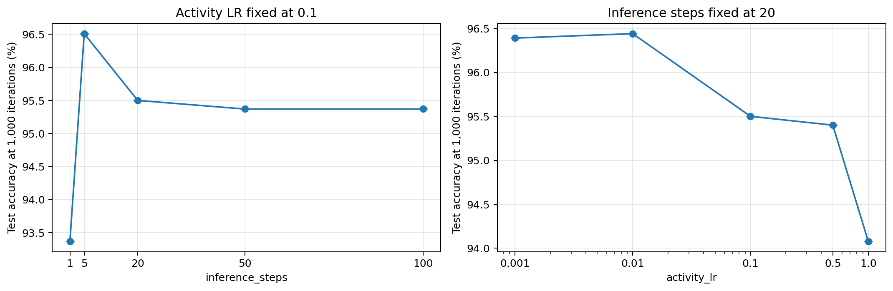
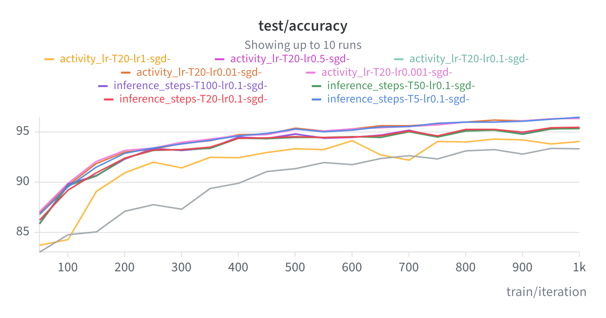

# Task 4 and 5 WandB Results
- Left graph: Fix learning rate at 0.1, vary inference steps and see how test accuracy after 1000 iterations changes
  - Accuracy improves significantly when inference steps becomes more than 1, but plateaus when inference steps goes past 20. It seems that increasing inference steps doesn't lead to much improvement after a certain threshold.
- Right graph: Fix inference steps at 20, vary learning rate and see how test accuracy after 1000 iterations changes
  - Accuracy decreases gradually at the beginning but drops steeply from 0.5 to 1, so it seems it is best to keep the learning rate in the neighborhood of 0.001 and 0.01.
  

# Full WandB Runs

